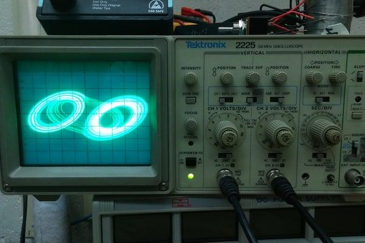
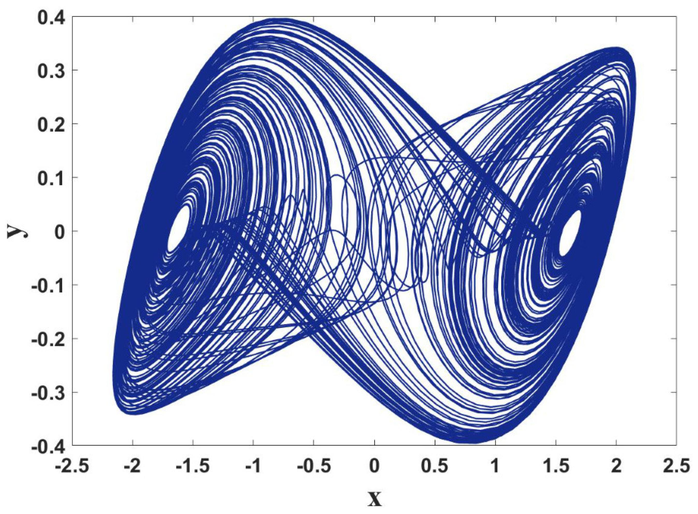

## Introduction

<b>Discipline | <b style="background-color:aqua;">INFORMATION TECHNOLOGY
:--|:--|
<b> Lab | <b> Chua’s Circuit Analysis for Electronic Chaos Generation.
<b> Experiment 1|     <b> Chua’s Circuit Analysis for Electronic Chaos Generation.

### About the Experiment 

Chua’s Circuit Analysis for Electronic Chaos Generation is a project that studies how a simple electronic circuit can generate chaotic signals using nonlinear components.

In simple words, it demonstrates how an electronic circuit can produce complex, irregular waveforms without any random input.

The project mainly focuses on:

Circuit design: Connecting resistors, capacitors, an inductor, and Chua’s diode.

Mathematical analysis: Studying the differential equations that describe the circuit.

Simulation: Using MATLAB/Simulink or LTspice to generate chaotic waveforms.

Chaos analysis: Observing the double-scroll attractor and how circuit parameters affect the output.

Applications: Exploring chaos-based communication, nonlinear systems, and signal generation.

<b>Name of Developer | <b> Brijmohan vishawakarma 

<b> Institute | <b> rajkiya Engineering College Banda  
<b> Email id| <b>  brijmohanv063@gmail.com 
<b> Department | <b> Information technology

### Contributors List

SrNo | Name | Faculty or Student | Department| Institute | Email id
:--|:--|:--|:--|:--|:--|
1 | Brijmohan vishawakarma | Brijmohan | INFORMATION TECHNOLOGY |rajkiya Engineering College Banda  | brijmohanv063@gmail.com
